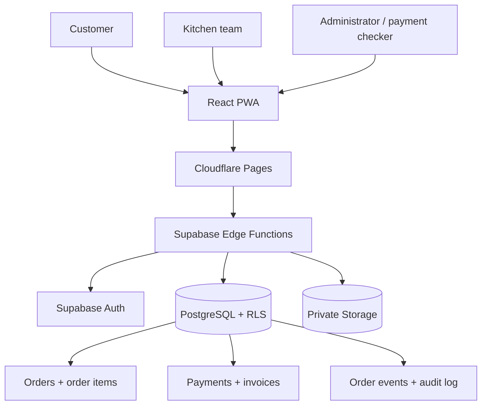

# System Architecture — BitesBro

## Status
Architect 1 / New Visual Architecture, prepared 28 October 2026. Proposed; approval pending.

## Context
A direct food-ordering website for customers, a live order list for the kitchen and controls for administrators. React PWA delivered by Cloudflare Pages; Supabase Edge Functions perform trusted validation and state changes; Supabase Auth, PostgreSQL/RLS and private Storage hold identities, records and evidence.

## Logical architecture

## Component responsibilities
| Component | Responsibility |
|---|---|
| React PWA | Role-appropriate responsive screens |
| Cloudflare Pages | Static frontend hosting |
| Supabase Edge Functions | Trusted server-side validation and writes |
| Supabase Auth | Identity and session tokens |
| PostgreSQL + RLS | Official records and row access control |
| Supabase Storage | Private evidence and approved documents |

## User groups
Customer: choose food, order and track status. Kitchen staff: receive accepted orders and update preparing/ready. Administrator: manage menu, prices, availability and reports. Payment checker: review unconfirmed payments and evidence.

## Critical workflow
Customer selects food; Edge Function validates current menu availability, price and tax; creates one PENDING order with unique request key; payment is verified from trustworthy provider/bank evidence or routed to human review; only verified/authorized orders enter kitchen preparation; kitchen updates preparing/ready; customer sees server-confirmed status.

## Deployment topology
- Separate development, staging and production configuration.
- Separate Supabase project and credentials for this product.
- Static frontend; privileged work only in trusted backend.
- Versioned migrations and controlled release process.
- Private storage buckets by default.
- Domain/DNS are not specified in source.

## Non-functional targets
- No successful cross-user permission tests.
- Duplicate submissions must not create duplicate official records.
- Initial p95 goal below two seconds in measured pilot testing; not an SLA.
- Confirm uptime, recovery, retention and backup requirements before launch.

## Out of scope
AI food-demand forecasting, loyalty program, complex driver location tracking, advanced dispatch, native apps and automatic gateway migration are later possibilities, not first-release commitments.

## Cost caveat
Free tiers are a bounded-pilot proposal only, not a guarantee of zero-cost production or
continuous availability. Recheck provider limits, region, storage, backups and support.
